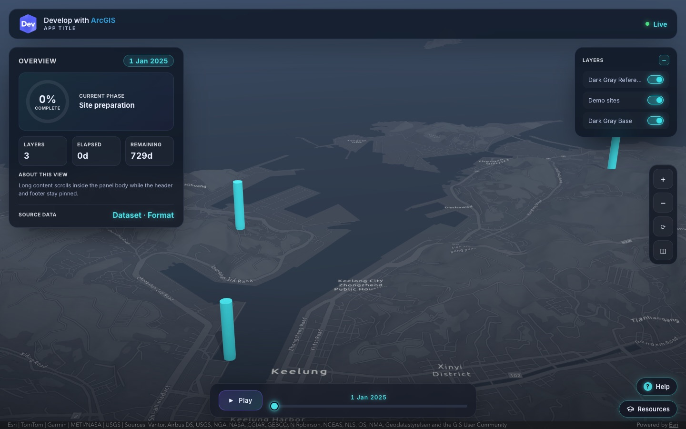

# ArcGIS JS App Template

A template for starting custom web apps with the [ArcGIS Maps SDK for JavaScript](https://developers.arcgis.com/javascript/latest/), packaged as an [agent skill](https://agentskills.io) for GitHub Copilot, Claude Code, Cursor, Codex and other AI coding agents. Ask your agent for a new app and it starts from this template instead of a blank page: Esri Developers branding, a loading screen, dark glass panels, a timeline dock, a welcome dialog, Help and Resources buttons, layer toggles, color themes and a screenshot mode.



The look comes from the [construction-timelapse](https://dchantlos.github.io/construction-timelapse/) app.

## Install

With [GitHub CLI](https://cli.github.com/) 2.90 or later:

```bash
# For all your projects
gh skill install dchantlos/arcgis-js-app-template arcgis-js-app-template --scope user

# For the current repository only
gh skill install dchantlos/arcgis-js-app-template arcgis-js-app-template
```

Add `--agent claude-code`, `--agent cursor` or `--agent codex` to install it for another agent. Get updates with `gh skill update arcgis-js-app-template`.

Without GitHub CLI, download this repository and copy the `skills/arcgis-js-app-template` folder into `~/.copilot/skills/` (GitHub Copilot, all projects), `~/.claude/skills/` (Claude Code) or a repository's `.github/skills/` (one project).

## Use

Ask in agent mode, for example:

- "Start a new ArcGIS app from the template for a stadium digital twin, seafoam theme"
- "Retrofit ./my-app to the template look"
- "Add a layer list panel" or "Review the app against the template checklist"

In VS Code you can also type `/arcgis-js-app-template new <app>` (or `retrofit`, `add`, `theme`, `review`).

The agent copies the kit and starter into your project, fills in the `EDIT` placeholders, replaces the demo scene with your web scene or web map, and removes the parts you don't need.

## Use it without an agent

The template also works on its own:

```bash
git clone https://github.com/dchantlos/arcgis-js-app-template.git
KIT=arcgis-js-app-template/skills/arcgis-js-app-template/assets
mkdir -p my-app/showcase
cp "$KIT"/{showcase.css,showcase.js,dev-logo.png,esri-logo.png,theme-cyan.css} my-app/showcase/
cp "$KIT/starter.html" my-app/index.html
cp "$KIT/starter.js" my-app/main.js
cd my-app && python3 -m http.server 8080   # any static server works; ES modules don't load from file://
```

Open <http://localhost:8080>. The demo scene needs no API key. Then search `index.html` and `main.js` for `EDIT`, and replace the `DEMO` parts of `main.js` with your own scene. [patterns.md](skills/arcgis-js-app-template/references/patterns.md) lists every component and its JavaScript helper.

## What's inside

| Path | Contents |
|---|---|
| [SKILL.md](skills/arcgis-js-app-template/SKILL.md) | What the agent follows: fixed and themeable rules, procedures (new app, retrofit, add component, theme, review) and validation |
| [assets/](skills/arcgis-js-app-template/assets) | The kit (`showcase.css`, `showcase.js`, `theme-cyan.css`, `theme-seafoam.css`, logos) and the starter (`starter.html`, `starter.js`) |
| [references/](skills/arcgis-js-app-template/references) | Component catalog, retrofit guide and QA checklist |
| [scripts/screenshots.mjs](skills/arcgis-js-app-template/scripts/screenshots.mjs) | Optional Playwright run: desktop, laptop, phone and `?clean` screenshots plus a console report |

## License

[Apache-2.0](LICENSE). Esri, ArcGIS, the Esri logo and the Esri Developers logo are trademarks of Esri and are not covered by this license. Apps built from the template must keep the Esri attribution ("Powered by Esri" and data sources) visible.
